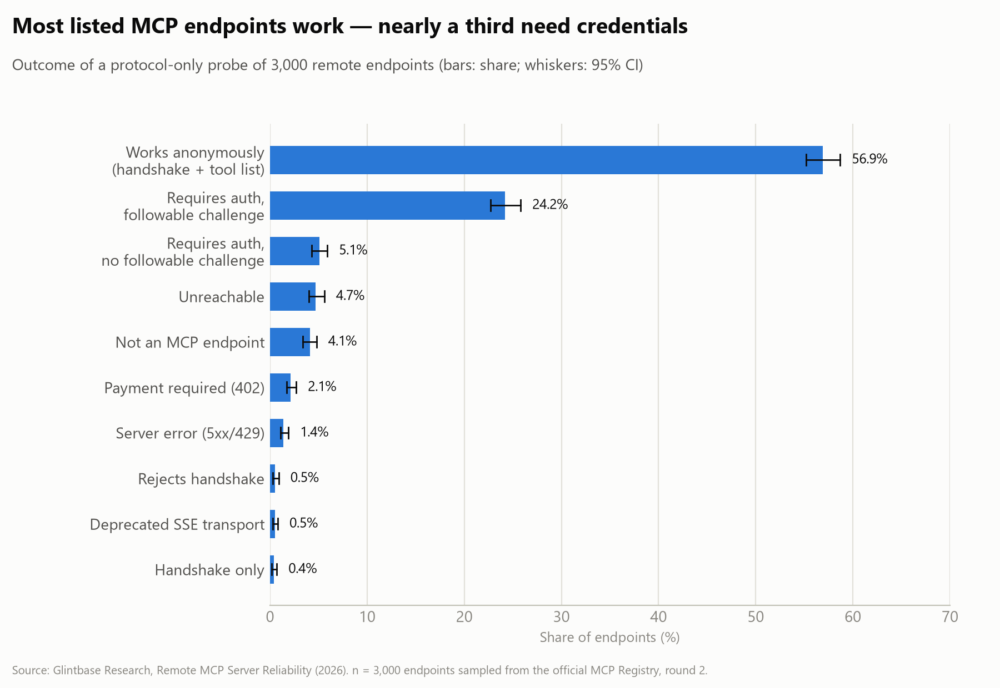
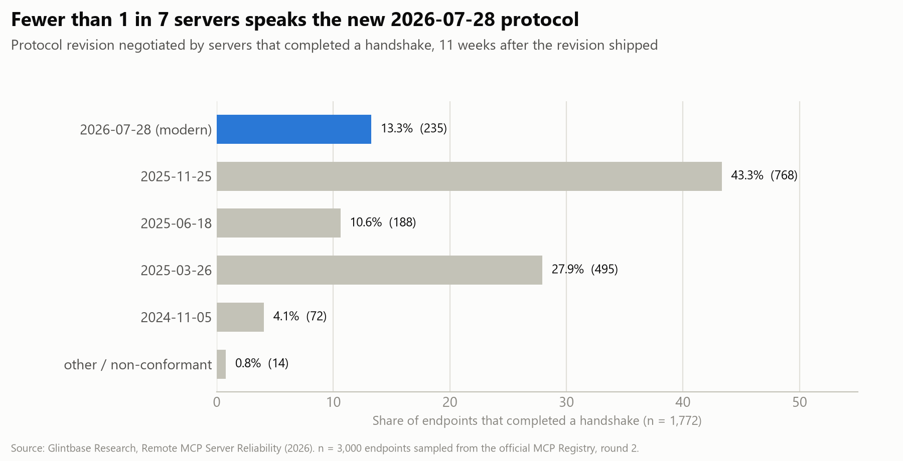
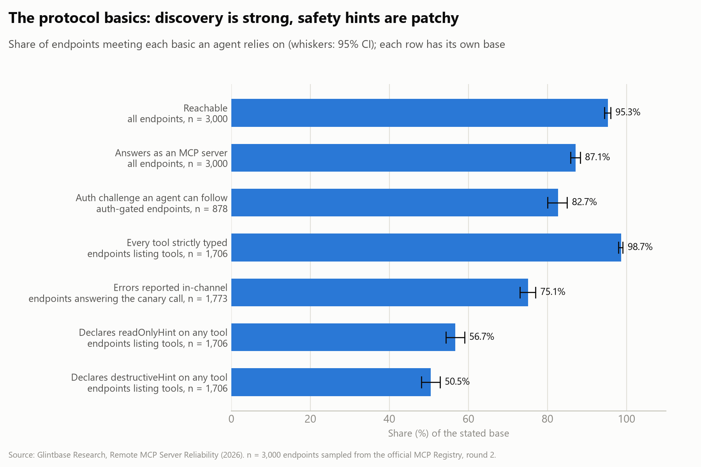
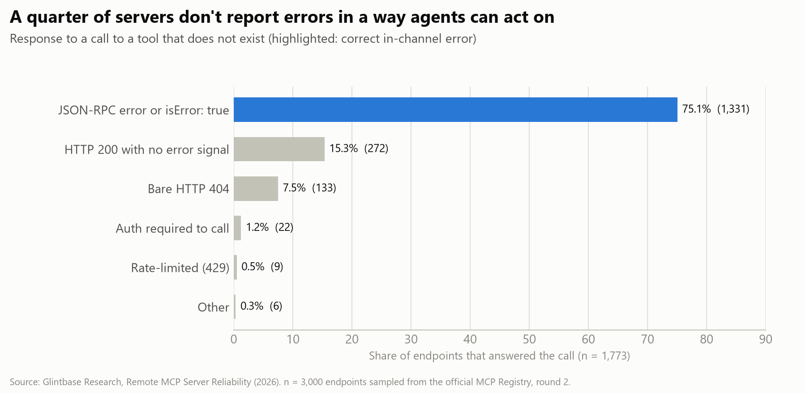

# Remote MCP Server Reliability (2026)

*A census of remote endpoints in the official MCP Registry*

**Glintbase Research · October 2026 · DRAFT, not yet published**
Pre-registration: [`PREREGISTRATION.md`](../PREREGISTRATION.md) (frozen in commit `6112785` before data collection) · Data: [`data/`](../data) · Harness: [`harness/`](../harness)

---

## Summary

We probed a random sample of **3,000 remote endpoints** (from 2,245 hosts) drawn from the 26,365 unique remote endpoints in the official MCP Registry, using only protocol and metadata requests. Every number below has a Wilson 95% interval in [`data/summary.md`](../data/summary.md).

- **Most listed endpoints work.** 95.3% were reachable and 87.1% answered as MCP servers. **56.9% completed a handshake and listed their tools anonymously** (48.1% when each host counts once).
- **Auth is common and mostly done right.** 29.3% required authentication. Of those, **82.7% gave a challenge an agent can follow:** a `Bearer` `WWW-Authenticate` header plus valid RFC 9728 protected-resource metadata.
- **The new protocol revision is still rare.** Of 1,772 completed handshakes, **13.3% spoke MCP `2026-07-28`**, published 11 weeks earlier; a quarter of those also accept older revisions. Among legacy servers, `2025-11-25` was the most common negotiated version (50.0%).
- **Tool metadata is strong where tools are listed.** Median 9 tools; 98.7% of endpoints declare strictly typed schemas for every tool, and all describe every tool. Safety annotations are patchier: 56.7% declare `readOnlyHint` on at least one tool, and 50.5% declare `destructiveHint`.
- **Error handling is the weakest basic.** Asked to call a tool that doesn't exist, **24.9% did not return an in-channel error**. 272 replied HTTP 200 with no error signal, and 133 gave a bare HTTP 404.
- **Small tails:** 2.1% demanded payment (HTTP 402), 1.4% were server errors, 4.1% didn't speak MCP, and 0.5% still used the deprecated HTTP+SSE transport.

- **Repeatable measurement:** re-probing immediately gave the same classification for 99.6% of endpoints, after excluding one host whose free anonymous quota our own probing had used up.

## 1. Why this study

Agents can only use an MCP server if the protocol basics work: the server answers, says which protocol revision it speaks, lists its tools in a form an agent can read, tells the agent how to authenticate when it needs credentials, and reports errors in a way the agent can act on. Public registries list tens of thousands of remote MCP endpoints, but there is little systematic data on how many of them get these basics right. This study measures that, descriptively, on a random sample of the official MCP Registry.

## 2. Method (summary of the pre-registration)

**Population.** The official MCP Registry was snapshotted on 2026-10-12 (`GET /v0/servers?version=latest`, fully paginated). That gave:
- 42,176 registry entries and 41,660 latest active servers;
- 26,619 servers with at least one remote endpoint, totalling 27,282 remote entries;
- 283 excluded because the URL contains template variables, and 634 duplicate URLs merged;
- a frame of **26,365 unique endpoints**.

**Sample.** A simple random sample of **3,000 endpoints** (seed `20261012`).

**Probe.** A dual-era client that follows the backward-compatibility procedure in MCP `2026-07-28`:
1. a modern `server/discover` request with per-request `_meta` and headers;
2. otherwise, the legacy `initialize` handshake, with sessions where issued;
3. otherwise, detection of the deprecated HTTP+SSE transport.

For servers that complete a handshake, it also sends `tools/list` and one call to a deliberately non-existent tool, to see how errors come back. For auth-gated servers, it fetches RFC 9728 protected-resource metadata.
- At most 8 requests per endpoint, one endpoint per host at a time.
- **No real tool was called and no security payload was sent.**
- The probe identified itself as `GlintbaseResearch/1.0`, linking to <https://glintbase.dev/research/bot>.

**Rounds.** Three pre-registration deviations apply (all logged before any analysis):
- **Re-test timing:** the re-test ran back to back with the headline round, not ≥ 6 h later.
- **Era-detection fix:** an era-detection rule was corrected to follow the spec, and every affected round was re-run.
- **Contaminated round discarded:** one round that overlapped another study's traffic on the same connection was discarded.

The **headline round is round 2** (2026-10-12, 17:24–17:53 UTC). **Round 3**, run immediately afterwards in isolation, is the re-test.

**Validation.** 30 endpoints, stratified by outcome, were re-checked with a separate minimal client (`harness/validate.py`), and every disagreement was reviewed against the raw logs.
- **Automatic agreement:** 23/30 (76.7%).
- **After review:** 30/30. All seven disagreements were traced to limitations of the deliberately simple validator: a stale era rule, no handling of POST 307 redirects, a blocking read on SSE streams, being rate-limited, and no version retry. One case also depended on the frozen rule order: auth is checked before `ok`.
- **Caveat:** the reviewer also wrote the probe, so this is a documented self-check, not an independent audit.

The pre-registered gate (≥ 90%) was met. Details are in [`data/validation.csv`](../data/validation.csv).

**Statistics.** Proportions with Wilson 95% intervals. Some hosts publish hundreds of registry endpoints, so endpoint-level shares are reported alongside **host-weighted** shares, where each host counts once.

## 3. Results

All shares are of the 3,000 sampled endpoints unless stated otherwise. Intervals are Wilson 95%.

### RQ1: Does the endpoint answer as an MCP server?

*Figure 1. Primary outcome of the probe for each sampled endpoint. Whiskers are Wilson 95% intervals.*

| Primary status | Endpoints | Share (95% CI) | Host-weighted |
|---|---|---|---|
| `ok`: handshake + anonymous `tools/list` | 1,708 | 56.9% (55.2–58.7) | 48.1% |
| `auth_compliant` | 726 | 24.2% (22.7–25.8) | 30.5% |
| `auth_noncompliant` | 152 | 5.1% (4.3–5.9) | 6.4% |
| `unreachable` | 142 | 4.7% (4.0–5.6) | 6.2% |
| `not_mcp` | 122 | 4.1% (3.4–4.8) | 4.3% |
| `payment_required` (HTTP 402) | 64 | 2.1% (1.7–2.7) | 1.2% |
| `server_error` (5xx/429) | 43 | 1.4% (1.1–1.9) | 1.8% |
| `jsonrpc_error` | 16 | 0.5% (0.3–0.9) | 0.6% |
| `legacy_sse` (deprecated transport) | 15 | 0.5% (0.3–0.8) | 0.6% |
| `handshake_only` | 11 | 0.4% (0.2–0.7) | 0.2% |
| `modern_rejected` | 1 | 0.0% (0.0–0.2) | 0.0% |

- **Hosts:** the sample spans 2,245 hosts, and the largest single host accounts for 261 endpoints. Host-weighted shares (each host counts once) are shown for comparison.
- **By transport:**
  - **streamable-http:** of the 2,868 endpoints the registry lists this way, 1,698 were `ok`.
  - **sse:** of the 132 listed with the deprecated `sse` transport, only 10 were `ok` and 15 still served the legacy SSE handshake. 54 returned HTTP 402, mostly from paid deployments.

### RQ2: Which protocol revision do they speak?

*Figure 2. Protocol revision spoken by servers that completed a handshake. Shares are of all 1,772 handshakes, so they differ from the "share of legacy servers" figures below.*

Among the 1,772 endpoints that completed a handshake:

- **13.3% (11.8–14.9) speak the modern `2026-07-28` revision** via `server/discover`. 25.1% of those also advertise legacy revisions (dual-era).
- **Legacy (`initialize`-based) servers** negotiated these versions:

  | Version | Share of legacy servers |
  |---|---|
  | `2025-11-25` | 50.0% |
  | `2025-03-26` | 32.2% |
  | `2025-06-18` | 12.2% |
  | `2024-11-05` | 4.7% |

- **Sessions:** 17.1% of legacy servers issued an `Mcp-Session-Id`.
- **Non-conformant replies:** 14 endpoints, all on one hosting platform, answer `server/discover` without the required `supportedVersions` field and claim `2026-07-28` in response to `initialize`. Under the pre-registered rule they are counted as legacy-era.
- **Latency:** the median handshake took 418 ms from the vantage point (residential, Nigeria).

### RQ3: Can an agent follow the auth challenge?

- **29.3% (27.7–30.9) of endpoints required authentication.** Of these:
  - **82.7% (80.0–85.0)** returned a compliant challenge (a `Bearer` `WWW-Authenticate` header and valid protected-resource metadata);
  - 88.2% sent a Bearer challenge;
  - 84.6% served valid metadata.
- **Auth only at call time:** 53 auth-gated endpoints completed the handshake and listed tools anonymously, but demanded auth only when a tool was called.

### RQ4: Is tool metadata usable?

*Figure 3. The protocol basics an agent relies on. Each row has its own base, stated under its label.*

Among the 1,708 `ok` endpoints (percentages are of the 1,706 that listed at least one tool):

| Metric | Value |
|---|---|
| Median tool count (first page of `tools/list`) | 9 |
| Zero tools listed | 2 endpoints |
| Every tool strictly typed | 98.7% |
| Every tool described | 100% |
| At least one `readOnlyHint` declared | 56.7% (54.3–59.0) |
| At least one `destructiveHint` declared | 50.5% (48.1–52.8) |

### RQ5: Are errors reported in-channel?

**75.1% (73.0–77.0)** of the 1,773 endpoints that answered the unknown-tool call over HTTP returned a JSON-RPC error or `isError: true`. The 442 that did not break down as:

| Response | Count |
|---|---|
| HTTP 200 without an error signal (e.g. an error message inside normal content) | 272 |
| Bare HTTP 404 | 133 |
| Required auth to call a tool | 22 |
| Rate-limited | 9 |
| Other | 6 |

*Figure 4. How servers answered a call to a tool that does not exist (RQ5).*

### RQ6: Re-test reliability

Round 3 re-probed all 3,000 endpoints immediately after round 2.

- **Overall:** 93.4% (92.4–94.2) kept the same primary status (Cohen's κ 0.895).
- **One host accounts for almost all changes:** 183 of 199 changes came from one gateway host (194 sampled endpoints) moving from `ok` to `auth_compliant`.
- **We caused that change.** Its anonymous tier allows 500 discovery requests and 50 tool calls per day, and **our own probing exhausted that daily quota**: we probed this host in several rounds that day, including the discarded ones. In round 3 it correctly responded with a compliant auth challenge. In round 2, 9 of its endpoints were already partly affected.
- **Without that host:** **99.6% (99.3–99.8)** of endpoints kept the same status (κ 0.994).

So the probe's classifications are highly repeatable over short intervals. This does not measure stability over days.

## 4. Limitations

- **One registry.** Listings are unvetted; Smithery and Glama are not included.
- **One vantage point, back-to-back rounds.** Stability over hours, days or weeks is not measured.
- **First page only.** Only the first page of `tools/list` is analysed.
- **Deprecated HTTP+SSE servers** are detected but not handshaken.
- **Some "failures" are deliberate:** for example, paid endpoints (HTTP 402) and servers that expect configuration headers declared in their registry entry.
- **Measurement can change the measured.** A gateway with a daily anonymous quota (194 sampled endpoints) began requiring auth after our repeated rounds. Bulk-hosted endpoints that share a quota are sensitive to repeated probing.
- **The protocol revision is recent.** Revision `2026-07-28` was published about 11 weeks before data collection, so adoption figures are an early snapshot.

## 5. Ethics

Metadata and protocol requests only, honest identification, a public bot page with opt-out, per-host serialisation, and small request volumes. Raw responses are not published. The report names no servers.

**What went wrong:** across this study's rounds, including discarded ones, we used up one gateway's free daily anonymous quota (500 discovery requests and 50 calls). **Mitigation for future rounds:** a per-host daily request cap, set below published anonymous quotas, and fewer re-runs per day.
