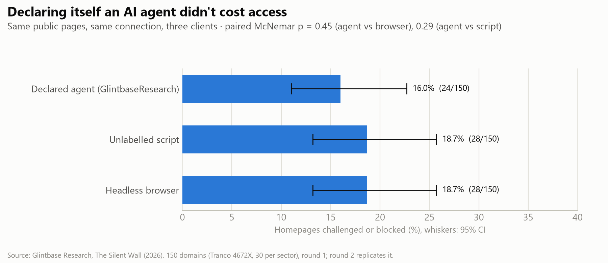
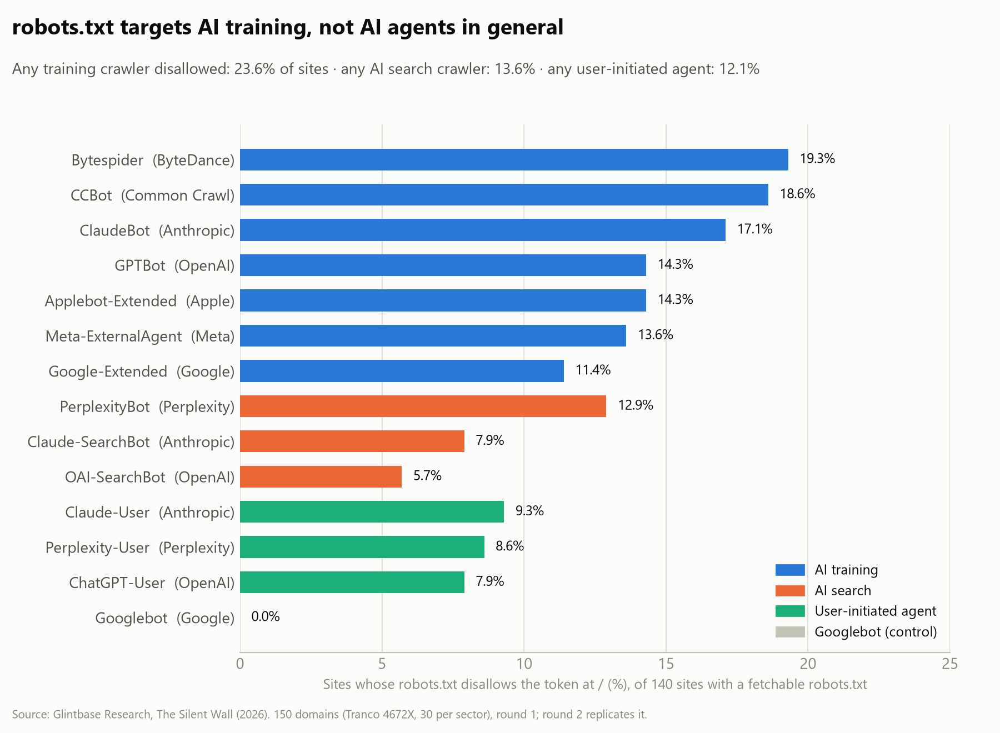
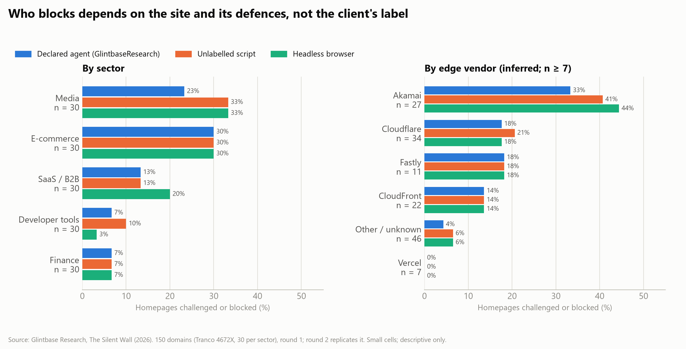

# The Silent Wall (2026)

*How popular websites' bot policies and edge defences treat a self-declared AI agent*

**Glintbase Research · October 2026 · DRAFT, not yet published**
Pre-registration: [`PREREGISTRATION.md`](../PREREGISTRATION.md) (frozen in commit `7113eda` before Part 2; three logged deviations) · Data: [`data/`](../data) · Harness: [`harness/`](../harness)

---

## Summary

We tested 150 popular websites, 30 in each of five sectors, from one residential connection, fetching the same public pages as three honest clients:
- **agent:** a self-declared research agent that follows `robots.txt`;
- **script:** an unlabelled HTTP script;
- **browser:** a headless browser.

Two rounds gave identical headline figures and agreed on 97–98% of individual results.

- **Being honest did not cost the agent access.** Its homepage was challenged or blocked on **16.0%** of sites (11.0–22.7), against **18.7%** for both the script and the headless browser. None of the paired differences is statistically significant (McNemar p ≥ 0.29).
- **Edges block clients, not labels.** On 19 of the 33 sites that challenged or blocked anyone, all three clients were stopped. Rates differ much more by sector and defence vendor than by identity:
  - e-commerce 30% and media 23–33%, against developer tools 3–10% and finance 7%;
  - Akamai-fronted sites 33–44%, against 0% on Vercel.
- **Written policy and edge behaviour diverge.** On **16.8%** of the sites whose `robots.txt` allows our agent, the edge still challenged or blocked it. In almost all of those cases the headless browser was stopped too; it got the page on only 2 sites (1.5%).
- **Policies single out AI training, not AI agents in general.** **23.6%** of sites with a fetchable `robots.txt` disallow at least one AI-training crawler at `/` (e.g. `CCBot` 18.6%, `ClaudeBot` 17.1%, `GPTBot` 14.3%). Only **12.1%** disallow a user-initiated agent such as `ChatGPT-User` or `Claude-User`, and no site disallowed `Googlebot`.
- **Small but telling edges:** 12 sites refused our agent even its `robots.txt` (HTTP 403). One answered with **402 Payment Required**, and one with a vendor-specific **498** block code.

## 1. Why this study

AI agents increasingly fetch web pages on behalf of people and companies. Site owners express what they allow in `robots.txt`, and enforce it, or something else entirely, at the network edge with CDNs and bot-management products. This study asks two questions:
- **Policy:** what do popular sites' published policies say about AI agents?
- **Behaviour:** does an agent that honestly identifies itself, and follows `robots.txt`, get treated differently from an unlabelled script or a headless browser fetching the same public pages?

**Scope.** We measure how sites treat a **declared but unverified** agent, which is what most independent and personal agents look like. We do **not** measure how sites treat OpenAI's, Anthropic's or other vendors' verified crawlers. Edges verify those by IP range, reverse DNS or cryptographic signatures, which we can't and shouldn't imitate.

## 2. Method (summary of the pre-registration)

**Sample.** 150 domains from the Tranco list `4672X`: 30 in each of SaaS/B2B, e-commerce, finance, media and developer tools, chosen by a written rule that walks the list from rank 1.

**Part 1, policy.** Each site's `robots.txt` was fetched once and parsed with an RFC 9309 parser (Protego). For 14 vendor-documented agent tokens we recorded whether the file names the token and whether `/` is allowed.

**Part 2, behaviour.** Each site's homepage and up to 3 public pages from its sitemap were fetched by three identities, in random order, from the same connection:

| Identity | Client | User-Agent |
|---|---|---|
| `agent` | HTTP client | `GlintbaseResearch/1.0 (+https://glintbase.dev/research/bot)`; obeys `robots.txt` |
| `script` | HTTP client | library default (`python-httpx`) |
| `browser` | headless Chromium | default (`HeadlessChrome`) |

- **Pacing:** ≤ 1 request/s per identity, ≥ 30 s between identities on a site, and fresh cookies for each.
- **Rounds:** two.
- **Stored:** only status, selected headers, cookie names, visible-text length, title and challenge-marker hits. Page bodies were not stored.

**Classification.** Pre-registered rules sort each response into `ok`, `thin`, `challenge`, `block`, `rate_limited`, `error`, `other` or `self_excluded`. CDN/WAF vendors are inferred from response headers.

**Deviations (all logged in the pre-registration):**
1. The robots census was re-run at lower concurrency, after self-inflicted connection failures.
2. Two connection outages (Deviations 2 and 4) invalidated parts of the runs. They were dated with a per-minute connectivity log, and every domain probed during an outage was discarded and re-probed.
3. Two defects in the browser identity's measurement (timeouts under concurrency, and error responses hidden by Chromium) were found after a first look at round-1 results. They were fixed, and **both rounds were re-run in full for all identities**.

**Validation.** 20 stratified domain × identity results were checked by hand against the stored evidence (status, headers, cookie names, markers, title, text length): **20/20 agreed** with the pre-registered rules. Three were correct under the rules but understate what happened: a vendor-specific 498 block and a 402 payment gate were both classed `other`, and a login wall was classed `ok`. The reviewer is also the harness author.

## 3. Results

Shares are of 150 domains unless stated otherwise. Intervals are Wilson 95%. Round 1 is the headline round; round 2 replicates it.

### RQ2: Are honest agents treated differently? (homepage)

*Figure 1. Share of homepages challenged or blocked, by client. The intervals overlap heavily and no paired difference is significant.*

| Outcome | agent | script | browser |
|---|---|---|---|
| **challenged or blocked** | **16.0%** (11.0–22.7) | **18.7%** (13.2–25.7) | **18.7%** (13.2–25.7) |
| …of which `block` | 8.7% | 11.3% | 11.3% |
| …of which `challenge` | 7.3% | 7.3% | 7.3% |
| `ok` | 69.3% | 64.7% | 70.0% |
| `thin` (little visible text) | 4.0% | 4.7% | 0.7% |
| `rate_limited` | 1.3% | 1.3% | 1.3% |
| `error` (incl. unreachable) | 7.3% | 8.7% | 6.7% |
| `other` | 1.3% | 2.0% | 2.7% |
| `self_excluded` (robots.txt) | 0.7% | — | — |

**Paired comparisons** (homepage challenged or blocked; excluding errors and self-exclusions):

| Comparison | Domains | Only first blocked | Only second blocked | McNemar p |
|---|---|---|---|---|
| agent vs browser | 137 | 2 | 5 | 0.45 |
| agent vs script | 135 | 2 | 6 | 0.29 |
| script vs browser | 137 | 5 | 4 | 1.00 |

- **Across all fetched pages,** not just the homepage, the agent was challenged or blocked on at least one page on 19.3% of sites, the script on 22.7% and the browser on 23.3%.
- **Repeatability:** between rounds, outcomes agreed for 97.3% (agent), 98.0% (script) and 96.7% (browser) of domains (κ 0.93–0.96).

### RQ1: What do robots.txt files say about AI agents?

*Figure 2. Share of sites whose robots.txt disallows each token at `/`, coloured by purpose.*

`robots.txt` could be fetched for 140 sites; 121 of those had a non-empty file.

| Token | Purpose | Named explicitly | Disallows `/` |
|---|---|---|---|
| `Bytespider` (ByteDance) | training | 22.9% | 19.3% |
| `CCBot` (Common Crawl) | training | 22.1% | 18.6% |
| `ClaudeBot` (Anthropic) | training | 25.0% | 17.1% |
| `GPTBot` (OpenAI) | training | 22.9% | 14.3% |
| `Applebot-Extended` | training | 19.3% | 14.3% |
| `Meta-ExternalAgent` | training | 18.6% | 13.6% |
| `Google-Extended` | training | 18.6% | 11.4% |
| `PerplexityBot` | search | 22.9% | 12.9% |
| `Claude-SearchBot` | search | 12.1% | 7.9% |
| `OAI-SearchBot` | search | 16.4% | 5.7% |
| `Claude-User` | user-initiated | 13.6% | 9.3% |
| `Perplexity-User` | user-initiated | 14.3% | 8.6% |
| `ChatGPT-User` | user-initiated | 17.9% | 7.9% |
| `Googlebot` (control) | search | 14.3% | 0.0% |

Sites disallowing **any** token of a purpose at `/`: training 23.6% (17.3–31.2), search 13.6%, user-initiated 12.1%. In addition, 12 sites answered HTTP 403 when our agent requested `robots.txt` itself.

### RQ3: Does the edge honour what the policy allows?

- Among the 137 sites whose `robots.txt` allows our agent at `/` (and which were reachable), the edge **challenged or blocked it on 16.8% (11.5–23.9)**.
- In almost all of those cases the headless browser was stopped too. It got the page on only 2 sites (1.5%).
- So the gap between policy and enforcement is mostly not aimed at AI: these edges stop non-human clients in general, whatever `robots.txt` says.

### RQ4: Where does blocking happen? (homepage challenged or blocked)

*Figure 3. Homepages challenged or blocked by sector and by inferred edge vendor (vendors with at least 7 sites). The cells are small, so read this as descriptive.*

| Sector | agent | script | browser |
|---|---|---|---|
| e-commerce | 30.0% | 30.0% | 30.0% |
| media | 23.3% | 33.3% | 33.3% |
| SaaS | 13.3% | 13.3% | 20.0% |
| finance | 6.7% | 6.7% | 6.7% |
| developer tools | 6.7% | 10.0% | 3.3% |

| Edge vendor (inferred) | Sites | agent | script | browser |
|---|---|---|---|---|
| Akamai | 27 | 33.3% | 40.7% | 44.4% |
| DataDome | 3 | 66.7% | 66.7% | 66.7% |
| Cloudflare | 34 | 17.6% | 20.6% | 17.6% |
| Fastly | 11 | 18.2% | 18.2% | 18.2% |
| CloudFront | 22 | 13.6% | 13.6% | 13.6% |
| Vercel | 7 | 0.0% | 0.0% | 0.0% |
| other/unknown | 46 | 4.3% | 6.5% | 6.5% |

Sector and vendor cells are small (n = 3–46), so treat them as descriptive. **Nine** domains were unreachable for every client from this vantage point, mostly Russian banks and crypto exchanges.

## 4. Limitations

- **One vantage point:** a residential connection in Nigeria (AS36873). Edge decisions depend on IP reputation and geography. All three identities share the IP, so comparisons *between identities* are controlled, but absolute rates may differ elsewhere. Nine domains, mostly Russian banks and crypto exchanges, were unreachable for every client from this location.
- **150 domains, one labeller,** and a keyword screen for finance and developer-tool candidates beyond Tranco rank 1,500.
- **Headless means headless.** The browser identity is identifiable as headless Chrome, so its results are not those of a human visitor.
- **Verified crawlers aren't covered.** The study does not measure their treatment, as above.
- **Policy as written:** `robots.txt` is recorded as written. OpenAI and Anthropic state that their user-initiated agents may not follow it.

## 5. Ethics

Honest identities only, no CAPTCHA solving or bypassing, public pages only, about 12 requests per site per round, a public bot page with opt-out, and no page bodies stored. Named domains appear only for public `robots.txt` facts.
